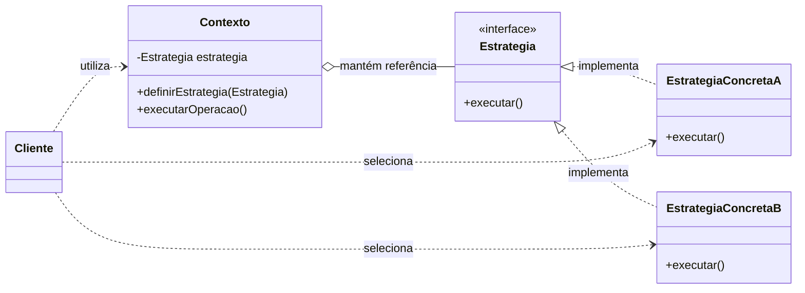
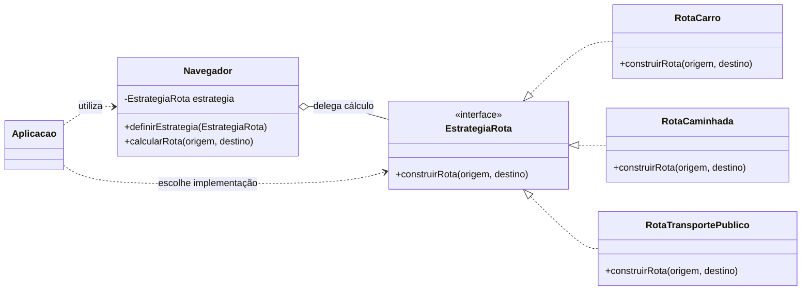

# [Strategy — Padrão de Projeto Comportamental](https://refactoring.guru/pt-br/design-patterns/strategy)

## 1. Introdução

O **Strategy (Estratégia)** é um padrão de projeto **comportamental** que define uma família de algoritmos, encapsula cada um deles separadamente e permite utilizá-los de maneira intercambiável. Assim, o objeto que precisa executar uma operação pode delegar sua realização a uma estratégia escolhida, sem depender da implementação concreta do algoritmo.

Na classificação de Gamma, Helm, Johnson e Vlissides (*Gang of Four — GoF*), o Strategy busca **definir uma família de algoritmos, encapsular cada um e torná-los intercambiáveis**, permitindo que o algoritmo varie independentemente dos clientes que o utilizam. Sua principal técnica é a **composição de objetos com delegação de comportamento**, em vez de concentrar todas as alternativas em uma única classe.

**Classificação:** comportamental.  
**Objetivo:** permitir a troca de algoritmos sem alterar o código do contexto que os utiliza.  
**Ideia central:** programar para uma abstração, não para uma implementação específica.

## 2. Problema que o padrão resolve

Quando uma classe precisa realizar uma mesma tarefa de diferentes maneiras, é comum que sua implementação acumule condicionais (`if`, `else` ou `switch`) para selecionar o comportamento desejado. Conforme novas alternativas surgem, essa classe tende a crescer, ficar mais difícil de testar e exigir modificações frequentes.

O Strategy propõe separar cada variação do algoritmo em uma classe própria, com um contrato comum. O contexto passa a delegar a operação à estratégia selecionada, reduzindo seu acoplamento às implementações concretas.

## 3. Modelo relacional do padrão (UML)

### Participantes e responsabilidades

| Participante | Responsabilidade |
| --- | --- |
| **Contexto (Context)** | Mantém uma referência a uma estratégia e delega a ela a execução do comportamento variável. |
| **Estratégia (Strategy)** | Define a interface comum para os algoritmos intercambiáveis. |
| **Estratégias concretas (Concrete Strategies)** | Implementam diferentes versões do algoritmo definido pela interface. |
| **Cliente (Client)** | Seleciona e fornece ao contexto a estratégia adequada para a necessidade. |

**Relações principais:** o contexto **possui uma referência** à interface Strategy (associação/agregação, conforme o ciclo de vida adotado); as estratégias concretas **implementam** essa interface; o cliente **configura** o contexto. Não é necessário que o contexto conheça as classes concretas.

## 4. Princípios SOLID relacionados

O uso de Strategy **favorece**, mas não garante automaticamente, os seguintes princípios:

| Princípio | Relação com o Strategy |
| --- | --- |
| **S — Single Responsibility Principle (SRP)** | Separa a responsabilidade de coordenar a operação (contexto) da responsabilidade de implementar cada algoritmo (estratégias concretas). |
| **O — Open/Closed Principle (OCP)** | Permite adicionar novas estratégias sem modificar o contexto, desde que o contrato comum seja mantido. |
| **L — Liskov Substitution Principle (LSP)** | Uma estratégia concreta deve poder substituir outra sem violar as expectativas estabelecidas pela interface (entradas, saídas e comportamento contratado). |
| **I — Interface Segregation Principle (ISP)** | Uma interface Strategy pequena e específica evita obrigar implementações a depender de métodos desnecessários. |
| **D — Dependency Inversion Principle (DIP)** | O contexto depende da abstração Strategy, e não diretamente das classes concretas que executam os algoritmos. |

**Destaque:** **OCP** e **DIP** são especialmente evidentes na estrutura do padrão. **SRP**, **LSP** e **ISP** dependem de decisões cuidadosas na implementação.

## 5. Exemplo-problema — aplicativo de navegação (Refactoring Guru)

O exemplo apresentado pelo **Refactoring Guru** começa com o desenvolvimento de um aplicativo de navegação urbana. Inicialmente, o sistema calcula rotas para deslocamentos **de carro**. Com o crescimento da aplicação, surgem pedidos para oferecer rotas **a pé** e por **transporte público**, além da possibilidade de adicionar percursos de bicicleta e roteiros turísticos.

Uma implementação inicial pode concentrar todos esses algoritmos na classe responsável pela navegação, utilizando condicionais para escolher o tipo de rota. Isso produz três dificuldades:

1. **Crescimento da classe:** cada novo meio de transporte exige mais código na mesma classe.
2. **Maior risco de regressões:** alterar o cálculo de um tipo de rota pode afetar funcionalidades já existentes.
3. **Conflitos de manutenção:** diferentes desenvolvedores precisam modificar o mesmo trecho de código para acrescentar ou corrigir algoritmos.

### Desafio de implementação

Refatore esse cenário aplicando o padrão **Strategy**, de modo que:

- cada modalidade de transporte tenha sua própria implementação de cálculo de rota;
- todas as modalidades obedeçam a um contrato comum, por exemplo, `construirRota(origem, destino)`;
- a classe `Navegador` delegue o cálculo à estratégia escolhida;
- o usuário possa trocar o meio de transporte sem alterar a implementação do navegador;
- uma nova modalidade possa ser adicionada com o mínimo de alterações no código existente.

### Modelo relacional aplicado ao exemplo

> **Observação:** os nomes das classes e os diagramas acima são adaptações didáticas do problema descrito pelo Refactoring Guru; não representam uma reprodução literal do código do site.

## 6. Quando utilizar

O Strategy é indicado quando:

- uma mesma operação admite diversos algoritmos alternativos;
- é necessário alternar o comportamento durante a execução;
- há condicionais extensas para selecionar variações de um algoritmo;
- deseja-se isolar implementações que mudam com frequência;
- o código cliente deve permanecer independente dos detalhes de cada algoritmo.

## 7. Vantagens e limitações

**Vantagens:** promove composição em vez de herança para variar comportamentos; facilita testes isolados; reduz o acoplamento; favorece extensão por novas estratégias; permite substituição de algoritmos em tempo de execução.

**Limitações:** aumenta o número de classes e abstrações; exige que o cliente ou outro componente saiba selecionar a estratégia apropriada; pode ser excessivo para poucos algoritmos simples que raramente mudam.

## 8. Relação com outros padrões

- **State:** apresenta estrutura semelhante, mas seu foco é alterar o comportamento conforme o estado interno do objeto, enquanto Strategy oferece algoritmos alternativos selecionáveis.
- **Template Method:** varia etapas de um algoritmo por herança; Strategy varia o algoritmo por composição e delegação.
- **Bridge:** também usa composição, porém busca separar uma abstração de sua implementação para que ambas evoluam independentemente.

## 9. Referências

1. GAMMA, Erich; HELM, Richard; JOHNSON, Ralph; VLISSIDES, John. **Padrões de Projeto: Soluções Reutilizáveis de Software Orientado a Objetos**. Porto Alegre: Bookman. Obra conhecida como *Design Patterns: Elements of Reusable Object-Oriented Software* (GoF), publicada originalmente em 1994.
2. REFACTORING.GURU. **Strategy**. Disponível em: https://refactoring.guru/pt-br/design-patterns/strategy. Acesso em: 10 nov. 2026.
3. REFACTORING.GURU. **Strategy em Java**. Disponível em: https://refactoring.guru/pt-br/design-patterns/strategy/java/example. Acesso em: 10 nov. 2026.

---

*Material de estudo sobre padrões de projeto. Diagramas e explicações elaborados para fins didáticos com base nas referências indicadas.*
